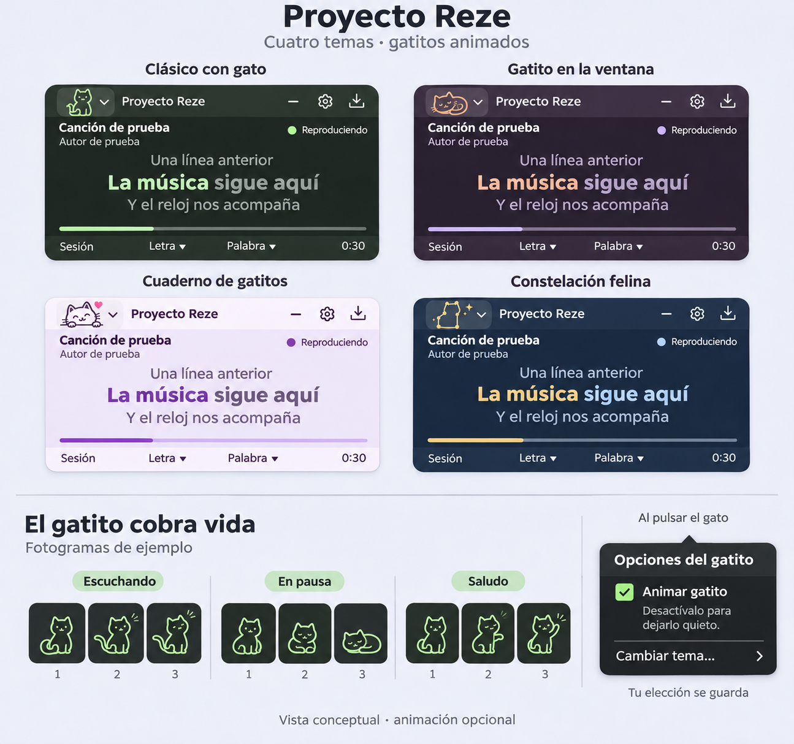
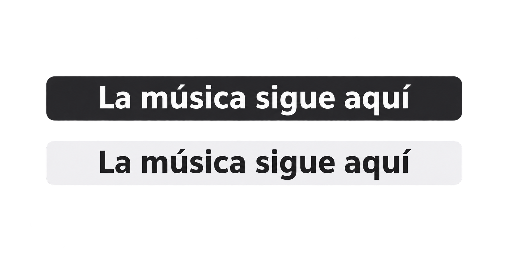

# Proyecto Reze · diseño felino y selector de temas

Fecha: 15 de noviembre de 2026. Documento elaborado con el proceso de planificación de **Impeccable**.

**Entrega:** especificación de diseño para otro agente. Este documento no implementa cambios en la aplicación. Las medidas, colores y composiciones siguientes son la propuesta a construir y comprobar, no resultados de un rediseño ya renderizado.

**Decisiones del usuario:** identidad bonita con gatos; dar prioridad a la letra y agrupar herramientas; ofrecer las cuatro direcciones mediante un selector si es viable; utilizar Clásico con gato como punto inicial y alternativa si la entrega necesita dividirse. Después de ver la imagen conceptual, pidió que el gatito se mueva mediante sprites y que su animación pueda activarse o desactivarse desde un menú.

**Decisión de alcance:** implementar un sistema de cuatro temas es viable con el stack actual. Cada tema comparte estructura, controles y comportamiento; cambia su expresión visual. El alcance completo incluye los cuatro. Una entrega parcial debe identificarse como tal y comenzar por Clásico con gato.

**Ampliación aprobada:** guardar la referencia visual de temas/sprites junto a este documento y añadir una vista Solo letras sin fondo general, con una banda de contraste detrás de la frase. La opción inicial será banda gris oscura y letra blanca; también se podrá elegir banda clara y letra oscura. Esto es una vista, no un quinto tema.

**Ampliación posterior solicitada:** incorporar anterior, reproducir/pausar y siguiente mediante Windows GSMTC. Estos controles ya forman parte de la interfaz implementada y sustituyen la restricción anterior de no añadir botones de transporte. El audio se mantiene en el reproductor externo. Consultar `playback_controls` y el IPC en [architecture.md](architecture.md).

## Referencias visuales para implementar

| Archivo local junto a este MD | Uso |
|---|---|
| [reze-temas-gatitos-sprites.png](reze-temas-gatitos-sprites.png) | Imagen conceptual aprobada por el usuario: cuatro temas, poses de ejemplo y menú de animación |
| [reze-solo-letras-contraste.png](reze-solo-letras-contraste.png) | Comparación de las dos bandas de contraste sobre un lienzo con transparencia real |
| Archivos `.png.json` contiguos | Procedencia de las imágenes y prompt de la vista Solo letras |





La segunda imagen compara alternativas: arriba **Oscuro**, abajo **Claro**. La aplicación muestra una sola alternativa y una frase activa a la vez. El área exterior a ambas bandas es transparente; un visor puede representarla negra o con un damero.

Son mockups generados mediante la herramienta integrada `image_gen`, no capturas de la aplicación implementada. La secuencia ilustrada no es la hoja final de sprites. Reconstruir texto, bandas y controles mediante HTML/CSS y producir los sprites finales con sus fuentes; no usar la imagen completa ni sus bordes rasterizados como fondo del producto. La imagen de temas contiene iconos aproximados: al implementar, conservar la semántica exacta de vista, ajustes y ocultar en bandeja descrita aquí, sin añadir una función de descarga.

## 1. Contexto para empezar

| Elemento | Referencia |
|---|---|
| Carpeta | `D:\Proyecto Reze` |
| Repositorio privado | `https://github.com/Seradox24/Proyecto-Reze` |
| Respaldo anterior al diseño | Etiqueta `respaldo-antes-diseno-2026-11-15` |
| Commit de respaldo | `505942c` |
| Rama de respaldo | `respaldo/antes-diseno-2026-11-15` |
| Documento de traspaso funcional | [HANDOFF_DISENO.md](HANDOFF_DISENO.md) |
| Diseño implementado actualmente | [DESIGN.md](../DESIGN.md) |
| Validación funcional previa | [rename-verification.md](rename-verification.md) |

Trabajar en una rama de diseño nueva, sin mover la etiqueta ni la rama de respaldo. Este documento describe el diseño objetivo. `DESIGN.md` seguirá describiendo la implementación actual hasta que el rediseño esté implementado y revisado.

No interpretar el valor `web` de `PRODUCT.md` como una petición de crear una web pública: la superficie es un widget Windows de Tauri, construido con HTML, CSS y TypeScript.

## 2. Propósito y criterio de diseño

**Modo Impeccable: Operate.** La persona trabaja en otra aplicación mientras escucha música y consulta la letra de reojo. Debe encontrar la frase actual antes que cualquier herramienta. La identidad felina aporta cercanía mediante color, dibujo y pequeños detalles; las acciones siguen siendo botones, menús, campos y selectores reconocibles.

La experiencia debe permitir:

1. Identificar qué canción se está siguiendo y si está en pausa.
2. Leer la frase actual y, cuando corresponda, reconocer la palabra que se canta.
3. Entender de inmediato cuándo la letra no dispone de seguimiento.
4. Corregir una búsqueda, importar un archivo o elegir una versión sin saturar la vista principal.
5. Elegir un tema y conservarlo al volver a abrir la aplicación.

La composición se mantiene estable entre temas. No presentar cuatro aplicaciones distintas ni cambiar la posición de las herramientas al cambiar de tema.

### Condiciones funcionales que debe conservar el diseño

- Windows GSMTC sigue siendo la fuente de sesiones, metadatos y posición. No añadir autenticación ni APIs de Spotify o YouTube.
- LRCLIB busca las letras; no pedir correo, URL, claves o cuentas al usuario.
- Conservar LRC y Lyricsfile YAML locales, incluida la importación por ruta y los archivos con advertencias recuperables.
- La preferencia por palabra no genera tiempos: si solo hay tiempos por línea, funciona por línea; sin sincronización utilizable, funciona como lectura.
- No reutilizar los segmentos por palabra del original en una traducción.
- La traducción se solicita explícitamente y conserva acceso al original. Cambiar de tema nunca debe iniciar solicitudes de letras o traducción.
- Conservar los desfases, la pausa, los saltos de posición, la selección de versiones, la recuperación de ventana y la bandeja.
- Conservar las opciones de tamaño, alineación, opacidad, nivel de ventana y movimiento reducido.

## 3. Arquitectura de la interfaz

Una ventana contiene siete superficies. Los paneles sustituyen temporalmente el área de trabajo dentro de esa ventana; no abren una segunda aplicación.

| Superficie | Contenido y tarea |
|---|---|
| Widget | Metadatos, letra, estado real de seguimiento y herramientas agrupadas |
| Menú Letra | Buscar, versiones, importar, corregir y traducir según disponibilidad |
| Menú del gato | Activar o desactivar la animación; acceso a Apariencia |
| Ajustes | Sesión, tema, seguimiento, apariencia, Internet y opciones avanzadas |
| Versiones | Comparar título, intérprete, duración y advertencias; elegir una versión |
| Corregir búsqueda | Editar título y artista de la pista actual |
| Traducir al español | Revisar idioma y autorizar el envío del texto; después alternar original/español |

No añadir reproducción de audio, biblioteca, listas, perfiles, chat, puntuaciones, simuladores de cuidado de mascotas ni juegos. El gato animado de marca no es una función de ChatGPT Pets ni depende de un servicio externo.

## 4. Composición del widget

### 4.1 Tamaño inicial: 420 × 260

Medidas en píxeles CSS; respetar el escalado de Windows. La ventana conserva su tamaño inicial y los límites nativos actuales.

```text
┌──────────────────────────────────────────────┐
│ gato · Proyecto Reze          vista ajustes −│
│ Título de la canción                         │
│ Artista                         Reproduciendo│
│                                              │
│              Línea anterior                  │
│          La música sigue aquí                │
│              Línea siguiente                 │
│                                              │
│ ━━━━━━━━━━━━━━━━━━━━━━━━━━━━━━━━━━━━━━━━━━━━ │
│ Sesión     Letra ▾          Línea ▾     0:30  │
└──────────────────────────────────────────────┘
```

El diagrama muestra jerarquía, no una tipografía monoespaciada para implementar. El menú y el selector de modo deben utilizar indicadores vectoriales reconocibles.

| Franja | Alto orientativo | Reglas |
|---|---:|---|
| Barra de ventana | 36 | Gato y marca a la izquierda; vista, ajustes y ocultar a la derecha |
| Metadatos | 44 | Título de una línea y artista; estado secundario; carátula solo si existe |
| Área central | Flexible; unos 132 | La letra domina; incluye los estados vacíos o de lectura cuando corresponda |
| Progreso | 10 | Trazo de 2 px con separación alrededor; sin interacción de búsqueda temporal |
| Herramientas | 36 | Sesión, Letra, modo efectivo y tiempo |

La suma debe caber en los 258 px interiores de una ventana de 260 px con borde. Estos presupuestos incluyen la separación interna de cada franja; no sumar márgenes verticales adicionales por fuera. Si faltan unos píxeles por métricas de fuente, reducir separaciones antes de recortar texto.

Margen horizontal habitual: 16 px; 12 px en la ventana mínima. Área central con al menos 8 px de separación respecto a metadatos y herramientas. El texto de la letra conserva la alineación elegida por el usuario.

### 4.2 Barra de ventana y marca

- Sustituir el monograma R por un gato original de 24 × 24 px, animado por sprites cuando esté permitido; 20 px en la ventana mínima. Mantener el nombre **Proyecto Reze**.
- El gato es un botón de 32 × 32 px que abre sus opciones. Nombre accesible: `Opciones del gatito`. Su dibujo interior es decorativo; el botón tiene foco y semántica reales.
- La etiqueta de marca y el espacio libre de cabecera sirven para arrastrar. Separar el botón del gato de esa zona: su pulsación o uso de teclado no debe iniciar el arrastre.
- Vista alterna compacta/solo letras; ajustes abre el panel; ocultar conserva el comportamiento de bandeja.
- No dibujar una X de cierre si el comando real solo oculta la ventana. Etiqueta: `Ocultar en la bandeja`.
- En 300 px se puede mostrar visualmente `Reze` si hace falta, manteniendo el nombre completo accesible y en el título nativo.
- La marca es secundaria frente a la canción. No aumentar la cabecera para acomodar una ilustración.

### 4.3 Metadatos

Título 14 px/600; artista 12 px/400. Un título largo tiene elipsis y acceso al contenido completo mediante descripción o tooltip, también con teclado. El artista admite el mismo tratamiento.

La carátula opcional mide 32 × 32 px. Si falta, retirar su espacio; no sustituirla por un bloque vacío ni por una imagen remota de gato. La mascota de marca sigue en la barra superior.

Mostrar `Reproduciendo` o `En pausa` como texto de apoyo. Su color no es la única diferencia entre estados. Los botones de anterior, reproducir/pausar y siguiente envían órdenes a la sesión Windows elegida y solo se habilitan si esa fuente las admite. En Solo letras se revelan con la cabecera mediante hover/foco; no ocupan el área de la frase cuando están ocultos.

### 4.4 Letra sincronizada

- Una frase central a 23 px/600 de inicio, configurable entre 14 y 64 px.
- Frase anterior y siguiente a 12–13 px/400, con color secundario y menor presencia.
- Permitir saltos por palabras y conservar la puntuación. No aplicar elipsis a la frase activa.
- En una ventana demasiado pequeña para la letra elegida, ofrecer desplazamiento del área central sin tapar las herramientas. No reducir silenciosamente el tamaño configurado.
- No animar cada actualización de posición con un desplazamiento completo de la frase.
- El progreso inferior es informativo. No convertirlo en un slider de seek: esa interacción no está implementada.

### 4.5 Menú Letra

El botón visible `Letra` agrupa las acciones secundarias. Evita la segunda fila permanente de botones que consume espacio en el diseño actual.

Orden del menú y comportamiento:

| Acción | Disponibilidad y destino |
|---|---|
| `Buscar letra` / `Volver a buscar` | Pista disponible y acceso a Internet; mantiene el flujo existente |
| `Versiones (N)` | Cuando existen candidatos; marcar la seleccionada y conservar avisos de coincidencia |
| `Importar archivo de letra…` | Pista disponible; selector nativo de LRC/YAML |
| `Abrir archivo por su ruta…` | Lleva a la opción avanzada existente; no elimina la alternativa al diálogo |
| `Corregir búsqueda…` | Pista disponible; si no hay Internet, explicar el requisito en lugar de fallar silenciosamente |
| `Traducir al español…` | Letra disponible, no instrumental y no identificada ya como español; apertura del panel de consentimiento |
| `Ver español` / `Ver original` | Traducción disponible; alterna el documento mostrado |
| `Cancelar traducción` | Solo mientras una traducción está en curso; también accesible desde su estado visible |

Mantener los cambios de estado actuales: búsqueda en curso no debe volver a lanzarse; elección de versiones no debe perder la vinculación a la pista. Las acciones no disponibles llevan una explicación breve cuando sea útil. No presentar como funcional una opción deshabilitada por falta de sesión o Internet.

Usar un popover o un menú que escape al `overflow` del widget; no debe quedar recortado por el borde redondeado. A 300 × 180, limitar su alto y permitir desplazamiento. Click fuera o Escape cierra; el foco vuelve a `Letra`.

### 4.6 Selector rápido de seguimiento

El control inferior indica el modo **efectivo**: `Línea`, `Palabra` o `Lectura`. Abre opciones de preferencia `Por línea` y `Por palabra`, con un texto que explique cualquier fallback.

- Si la preferencia es palabra y el archivo solo permite línea, mostrar `Línea` y explicar: `Esta letra no tiene tiempos por palabra. Seguimiento por línea.`
- Si no hay sincronización utilizable, mostrar `Lectura`; permitir conservar la preferencia, pero no prometer que cambiarla creará tiempos.
- Antes del primer segmento, un estado como `Esperando la primera línea` evita sugerir un error.
- Sin letra o con una pista instrumental, usar un estado neutro o deshabilitado; no anunciar karaoke activo.
- La preferencia se comparte con el selector de Ajustes y usa el guardado existente.

## 5. Lectura sin tiempos: estado de alta prioridad

Este requisito viene de una petición explícita del usuario. El cambio visual debe reforzarlo.

```text
┌──────────────────────────────────────────────┐
│  Modo lectura · sin tiempos                   │
│  Esta letra no tiene marcas de tiempo.        │
├──────────────────────────────────────────────┤
│                                              │
│  Texto de la letra sin resaltado.             │
│  El usuario lo desplaza para leer.            │
│                                              │
└──────────────────────────────────────────────┘
```

El contenedor superior permanece fijo **dentro del área central**; solo el texto inferior se desplaza. No convertir el aviso en un toast que desaparece ni colocarlo sobre la primera línea.

| Causa | Título | Explicación |
|---|---|---|
| Letra plain | `Modo lectura · sin tiempos` | `Esta letra no tiene marcas de tiempo. Se muestra sin seguimiento ni resaltado.` |
| Versión sin confirmar | `Modo lectura · versión por confirmar` | `Confirma esta versión en Versiones para activar el seguimiento.` |
| Posición de Windows no utilizable | `Modo lectura · sin posición fiable` | `Windows no proporciona una posición utilizable. Puedes leer la letra.` |

Prioridad de causas: letra sin tiempos primero; para una letra temporizada, versión pendiente antes que falta de posición. El estado debe calcularse desde la misma lógica que decide si se permite sincronizar.

Título de 13 px/700, fondo semántico de aviso y texto de alto contraste. No usar rojo para una letra plain: es una capacidad del archivo, no un fallo crítico. A alturas pequeñas se oculta la explicación, conservando siempre título y motivo.

La letra de lectura usa color neutro, peso 400, interlineado 1,5–1,6, sin gradiente karaoke, relleno de progreso, línea activa ficticia, pulso ni desplazamiento automático. Preservar su scroll cuando llegan nuevos snapshots de la misma letra.

## 6. Sistema visual compartido

### Tipografía

Usar `Segoe UI Variable`, `Segoe UI`, sans-serif del sistema; sin descarga de fuentes. Una sola familia permite que los gatos sean el detalle expresivo y los controles sigan siendo familiares.

| Uso | Tamaño / peso | Interlineado |
|---|---|---|
| Nombre de producto | 12 / 500 | 1,2 |
| Título de pista | 14 / 600 | 1,3 |
| Artista y estado | 12 / 400 | 1,35 |
| Frase actual | Valor del usuario, inicio 23 / 600 | 1,25–1,35 |
| Contexto de letra | 12–13 / 400 | 1,35 |
| Texto de lectura | Valor del usuario / 400 | 1,5–1,6 |
| Título de panel | 17 / 600 | 1,3 |
| Campos y acciones | 12 / 400–600 | 1,4 |
| Ayuda, fuente y tiempo | 11–12 / 400 | 1,45 |

Usar cifras tabulares para tiempo y desfase. Evitar mayúsculas extendidas, fuentes manuscritas en controles y caracteres diminutos para hacer que todo quepa. El texto es español; cada campo mantiene una etiqueta visible.

### Espaciado, forma y controles

- Escala de espacios: 4, 8, 12, 16, 20 y 24 px. Usar 6 px solo para ajustar estados muy compactos.
- Objetivo de interacción de 32 × 32 px en iconos y al menos 24 × 24 px cuando el mínimo de ventana lo exija; el dibujo interior sigue midiendo 16–18 px.
- Campos de 32–36 px de alto; radio 8 px. Botones con la misma altura y vocabulario visual en todos los paneles.
- Un botón principal por formulario; secundarios discretos y acciones de salida separadas del guardado.
- Foco visible con contorno de 2 px y separación de 2 px. Nunca depender de una sombra apenas perceptible.
- Usar bordes para entradas y separaciones necesarias; evitar envolver cada texto en una tarjeta.
- Mantener HTML semántico y controles estándar. Un icono de pata no reemplaza el icono de ajustes, el indicador de un selector ni el botón de ocultar.

### Estados de componentes

| Estado | Regla común |
|---|---|
| Reposo | Contraste legible y forma consistente |
| Hover | Cambio leve de superficie; no salto de tamaño |
| Focus | Anillo explícito visible en todos los temas |
| Pressed | Superficie más definida; sin encoger toda la ventana |
| Selected | Marca y texto; el color acompaña, no sustituye la indicación |
| Disabled | Atenuación moderada y atributo nativo; conservar lectura del motivo |
| Loading | Texto de estado estable; impedir dobles solicitudes |
| Error | Mensaje cercano a la acción, persistente mientras requiera corrección |

## 7. Los cuatro temas

Los nombres son de presentación; los identificadores permanecen estables y no contienen espacios. La tabla es una propuesta de tokens compartidos, no CSS listo para copiar sin comprobar su contexto.

| Token / rol | Clásico con gato `classic_cat` | Gatito en la ventana `window_cat` | Cuaderno de gatitos `cat_notebook` | Constelación felina `cat_constellation` |
|---|---|---|---|---|
| Fondo principal | `#1A1F1C` | `#211B2A` | `#F4F0FA` | `#151E35` |
| Superficie de controles | `#242C25` | `#2C2437` | `#FFFCFF` | `#1E2A45` |
| Superficie elevada | `#2F3930` | `#382E44` | `#EAE2F5` | `#2A3856` |
| Texto principal | `#F2F3EE` | `#F7F1F8` | `#30243B` | `#F2F5FF` |
| Texto secundario | `#AEB6AA` | `#C8BCD0` | `#67566F` | `#BCC8E3` |
| Acento / palabra cantada | `#C1E8B3` | `#F3B59E` | `#7241A0` | `#F2CD8A` |
| Palabra pendiente | `#AEB6AA` | `#B9ACBF` | `#67566F` | `#BCC8E3` |
| Texto sobre botón de acento | `#14200F` | `#321E25` | `#FFFFFF` | `#20283F` |
| Foco | `#D8F7C8` | `#C7B3F4` | `#7241A0` | `#B7CBFF` |
| Borde de campo | `#84937C` | `#93839F` | `#8A7698` | `#7E91B8` |
| Fondo de aviso de lectura | `#353226` | `#463522` | `#FFF0C9` | `#44371F` |
| Texto de aviso | `#F3D5A1` | `#FFE0AD` | `#5C4100` | `#FFE1AA` |
| Error | `#F3B5A7` | `#FFB4C1` | `#A32142` | `#FFB5C1` |
| Radio exterior | 12 px | 18 px | 14 px | 14 px |

Definir estos roles una vez y cambiar sus valores por tema. Los colores de contexto, botones, campos, progreso, avisos y palabras deben consumir los mismos tokens; no dejar restos del verde actual en los otros temas.

### 7.1 Clásico con gato · tema inicial

**Escena:** la persona trabaja con varias ventanas y quiere reconocer el widget de un vistazo sin cambiar bruscamente su aspecto habitual.

Conserva el verde carbón y la línea verde suave, pero adopta la jerarquía nueva y el menú de herramientas. Un gato de trazo sencillo ocupa la posición del monograma. En el estado inicial puede aparecer el mismo gato, sentado, a 40 px.

El gesto distintivo es la silueta felina sobria de marca. No llenar la superficie de huellas ni redibujar los controles con formas de gato. Es la base funcional y visual con la que comprobar el sistema de temas.

### 7.2 Gatito en la ventana

**Escena:** escuchar música al terminar el día con un widget cálido sobre un escritorio oscuro.

Fondo ciruela, texto marfil, acento melocotón y foco lavanda. Gato acurrucado con una cola curva, representado como una silueta compacta. La curva de la cola inspira el dibujo de marca y una única línea ornamental corta en el estado vacío; no sustituye el progreso de reproducción.

La mascota mueve suavemente la cola mientras se reproduce música y se acurruca al pausar, mediante las secuencias de sprites de la sección 7.6. Los bordes son algo más suaves que en Clásico; las medidas de contenido y los controles permanecen iguales.

### 7.3 Cuaderno de gatitos

**Escena:** la persona prefiere una presencia luminosa y amable, coherente con un escritorio claro.

Base lavanda muy clara, controles casi blancos, texto ciruela y karaoke violeta. Gato de línea limpia con un pequeño detalle rosa reservado a su ilustración. Las áreas grandes se tiñen de lavanda; no presentar toda la identidad como una pantalla blanca con un único botón violeta.

El gesto distintivo es un pequeño dibujo felino de margen junto a la marca o al mensaje vacío. No dibujar renglones detrás de la letra, pegatinas sobre campos, papel con textura ni tipografía de cuaderno en los controles. La palabra cantada usa violeta oscuro para conservar contraste sobre el fondo claro.

### 7.4 Constelación felina

**Escena:** un escritorio nocturno donde la letra destaca sobre un fondo azul profundo.

Fondo azul noche, texto frío, karaoke dorado suave y foco azul claro. La marca es un contorno de gato con unos pocos puntos unidos; una o dos estrellas pequeñas pueden acompañarla dentro de la cabecera.

El gesto distintivo es ese gato trazado como constelación. Los puntos son decorativos, no representan progreso, conexión ni intensidad de audio. El contorno del gato puede cambiar de pose mediante sprites; las estrellas quedan estáticas. No usar un campo de estrellas detrás de las letras, destellos, partículas ni parallax. Los campos, menús y ajustes siguen siendo controles normales.

### 7.5 Reglas de ilustración y recursos

- Dibujos originales y locales. Conservar fuentes vectoriales editables y exportar las poses a hojas de sprites PNG con transparencia. No hacen falta fotografías, fuentes remotas ni servicios de imágenes para ejecutar la aplicación.
- Familia consistente: trazos redondeados de aproximadamente 1,75 px sobre una caja de 24 px; simplificar detalles a 16 px.
- Dos escalas: mascota de cabecera de 24 px —20 px en la ventana mínima— y estado vacío de 40–48 px. A 300 × 180, ocultar la ilustración grande antes de quitar espacio al mensaje o a su acción.
- Una mascota animada por ventana. Si el estado vacío muestra el gato grande, la cabecera usa un fotograma estático; no ejecutar dos animaciones del mismo gato simultáneamente.
- Los dibujos tienen `aria-hidden="true"`; únicamente el botón contenedor de la cabecera recibe foco y abre su menú. La ilustración de un estado vacío permanece no interactiva.
- No utilizar emojis como logotipo ni personajes comerciales. El nombre Proyecto Reze se conserva.
- No añadir orejas por fuera de la ventana: quedarían recortadas y podrían interferir con arrastre y redimensionado.
- El ejecutable y la bandeja utilizan un único icono felino legible. No es necesario cambiar recursos del ejecutable ni reconstruir la bandeja al cambiar el tema de la interfaz.
- Los recursos internos pueden organizarse en `assets/themes/` o `ui/src/assets/`, respetando la CSP actual y evitando SVG con scripts o recursos externos.

### 7.6 Gatito animado por sprites

**Intención de movimiento:** el gato parece acompañar la escucha. Mueve cabeza, orejas o cola dentro de su propia caja, descansa al pausar y puede saludar brevemente al interactuar. La mascota no recorre el widget ni invade la letra. Este movimiento es una preferencia explícita del usuario y conserva una alternativa estática completa.

La apariencia continúa siendo la de la imagen conceptual: dibujos suaves y legibles. Usar sprites no obliga a convertir todo el producto en pixel art. Cada tema tiene su propia familia de poses, con la misma duración y lógica.

#### Menú y preferencia

Al pulsar el gato, abrir un pequeño popover `Opciones del gatito` con:

1. Casilla `Animar gatito`, activada inicialmente salvo que una preferencia de movimiento reducido suprima su efecto.
2. Ayuda: `El gatito se mueve mientras escuchas. Puedes dejarlo quieto cuando quieras.`
3. Acción secundaria `Cambiar tema…`, que abre Apariencia sin duplicar el selector de temas.

La casilla aplica y guarda el cambio de inmediato mediante el comando de ajustes existente. No requiere reiniciar ni esperar al final de la animación. Si falla el guardado, restaurar el valor anterior y explicar el error. Cerrar el popover conserva el cambio ya guardado. El foco vuelve al gato al cerrar con Escape o al pulsar fuera; el menú no queda recortado por el widget.

Repetir `Animar gatito` en Ajustes → Apariencia, enlazada a la misma preferencia. Dentro del formulario se previsualiza y se guarda con `Guardar ajustes`; Volver/Escape descartan ese cambio no guardado. No abrir ambos editores de la preferencia a la vez. Si el menú guardó antes un valor, Ajustes debe abrirse con ese valor actualizado.

Apagado significa mostrar una pose estática apropiada, no esconder el gato. La casilla del menú y la de Ajustes controlan exclusivamente la mascota: no cambian la sincronización, el relleno de palabras ni la preferencia global de movimiento reducido.

#### Estados y secuencias

| Estado | Secuencia propuesta | Activación y salida |
|---|---|---|
| Reposo | 4 fotogramas a 4 fps: parpadeo y pequeño movimiento de oreja, una vez cada 6–8 s | Sin pista activa o tras volver al estado vacío; no usar un bucle agitado |
| Reproduciendo | 8 fotogramas a 8 fps: cola y cabeza con movimiento corto y suave | Bucle únicamente mientras `playing` sea verdadero y el dibujo sea visible |
| En pausa | 6 fotogramas a 4 fps: se acomoda o cierra los ojos | Una vez al entrar en pausa y después mantiene la última pose; no reiniciar por cada snapshot |
| Saludo | 6 fotogramas a 8 fps: levanta una patita | Una vez en la primera interacción por entrada de puntero o foco; no repetir mientras permanezca sobre el botón |
| Búsqueda iniciada | 6 fotogramas a 6 fps: mira a un lado | Una vez al iniciar una búsqueda de letra; luego vuelve al estado base. No es el único indicador de carga |
| Estático | 1 fotograma definido para cada estado base | Preferencia apagada, movimiento reducido o fallo del recurso animado |

No hay análisis de audio ni datos de tempo en el contrato actual. El movimiento acompaña la reproducción; no anunciar que baila al ritmo real de la canción ni inventar pulsos obtenidos de GSMTC.

Prioridad: animación deshabilitada o movimiento reducido → pose estática; ventana/dibujo ocultos → suspender el motor; al volver visible → resolver el estado base actual. Un saludo o una mirada pueden interrumpir brevemente el bucle de reproducción, pero un cambio de pista o de pausa cancela ese gesto y actualiza el estado de inmediato. La frase activa y sus tiempos nunca dependen de estas secuencias.

#### Recursos y encuadre

- Una hoja por tema: 8 columnas × 6 filas, fotogramas fuente de 48 × 48 px sobre fondo transparente; tamaño de la hoja 384 × 288 px. Ese recurso se muestra normalmente a 24 × 24 px por fotograma.
- Filas propuestas: reposo, reproducción, pausa, saludo, búsqueda y póster estático. Las secuencias de menos de 8 cuadros declaran su longitud real; no reproducir las celdas vacías.
- Manifiesto local por tema con versión, dimensiones, filas, número de cuadros, fps, repetición y fotograma estático por estado base. Esos pósteres pueden apuntar a un cuadro de las otras filas —por ejemplo, el último de pausa—; la sexta fila contiene un póster neutro de respaldo. El agente puede adaptar el formato, pero debe entregar datos explícitos y validados, no asumir que todas las filas tienen ocho cuadros.
- Para una ilustración vacía de 48 px, exportar una variante a resolución suficiente o renderizar sus fuentes vectoriales; no ampliar el recurso de cabecera de forma borrosa. También puede quedar estática sin perder ninguna función.
- Todos los cuadros conservan escala, anclaje y caja. Dejar margen interno suficiente para orejas, cola y patita en todas las poses. Ningún cuadro cambia el tamaño del botón ni desplaza la cabecera.
- No usar GIF como recurso principal: dificulta detenerse en una pose definida y controlar el estado. PNG y un avance de fotogramas controlable son suficientes. No incorporar una librería de juegos o animación para este caso.
- Los gráficos de cada tema deben contrastar sobre su propio fondo y seguir siendo reconocibles en la pose estática. Evitar celdas semitransparentes residuales o sangrado del cuadro contiguo al escalar.

#### Persistencia y accesibilidad

Ampliación adicional de `Settings`: `cat_animation_enabled: boolean`, inicial `true`. Configuraciones anteriores conservan sus valores y reciben este valor por defecto. Si el campo almacenado es inválido, recuperar solo esta preferencia. Guardarla en el mismo archivo que `theme_id`, sin nuevo servicio ni cuenta.

La animación efectiva requiere: preferencia activada, `settings.reduced_motion` desactivado, `prefers-reduced-motion` sin reducción y mascota/ventana visibles. Cualquiera de esas condiciones puede detener el motor sin borrar la preferencia guardada. Con movimiento reducido, la ayuda del menú indica `Animaciones detenidas por movimiento reducido`; no debe parecer que la casilla falló.

Ocultar en bandeja, minimizar o dejar el dibujo fuera de la superficie activa detiene el avance y elimina el trabajo periódico innecesario. Perder foco de ventana no equivale a estar oculta: una persona puede consultar el widget mientras escribe en otra aplicación. En Solo letras, la pequeña mascota permanece estática para no distraer; se puede animar mientras su control esté revelado por hover/foco y las demás condiciones lo permitan. La decisión no altera la preferencia guardada.

Al desactivar, reducir movimiento o cambiar tema, cancelar secuencias pendientes. Al reactivar, comenzar desde el estado de reproducción actual, sin reproducir saludos o búsquedas antiguos. Las poses se cambian sin anuncios de lector de pantalla; se anuncia el estado de la casilla, no cada fotograma.

#### Ejecución y degradación

Un módulo de presentación como `ui/src/mascot.ts` puede mantener el estado visual y el avance de cuadros. Usar CSS con `steps()` o un planificador limitado a la tasa declarada; no enviar comandos Rust ni reconstruir DOM a 8 fps. El reloj del gato es independiente del reloj de letras. El cambio de estado se calcula al cambiar sus entradas relevantes, no se reinicia con cada tick GSMTC.

Precargar los recursos locales del tema, mostrar un póster mientras cargan y cancelar el planificador al desmontar. Si falta una hoja o su manifiesto es inválido, mostrar el gato estático y conservar plenamente el menú, la canción y la letra. No descargar sprites durante la escucha ni añadir captura de pantalla o micrófono.

## 8. Selector de temas y guardado

Ubicación: **Ajustes → Apariencia → Tema**. Utilizar un selector estándar con las cuatro opciones, una miniatura estática del tema elegido y una línea de ayuda. No gastar el panel compacto en cuatro tarjetas grandes.

Orden:

1. Clásico con gato.
2. Gatito en la ventana.
3. Cuaderno de gatitos.
4. Constelación felina.

Al seleccionar, mostrar una vista previa en la ventana y en el propio panel, manteniendo foco y posición de scroll. La selección se persiste únicamente al usar `Guardar ajustes`. Volver o Escape restaura el tema guardado, como el resto de las preferencias visuales no confirmadas. Cambiar de tema no cierra paneles, no reinicia la canción y no altera la letra activa.

### Cambio de datos necesario para el agente implementador

Actualmente no existe un campo de tema. La implementación completa necesita una ampliación pequeña y explícita del contrato de ajustes:

| Elemento | Requisito |
|---|---|
| Campo propuesto | `theme_id` |
| Valores | `classic_cat`, `window_cat`, `cat_notebook`, `cat_constellation` |
| Valor inicial | `classic_cat` |
| Configuración antigua sin campo | Cargar con Clásico con gato, conservando el resto |
| Valor desconocido al cargar | Recuperar solo el tema a Clásico; no reiniciar todos los ajustes |
| Persistencia | Mismo archivo de preferencias y guardado atómico existentes |
| Vista previa | Estado temporal de formulario; no escribir a disco por cada selección |

Actualizar `Settings` en Rust, sus valores por defecto y lectura tolerante, el tipo TypeScript y el formulario. Una opción aditiva con valor por defecto no requiere cambiar por sí sola el número de esquema; conservar compatibilidad y probarlo. La decisión exacta de representación —enum o cadena normalizada— corresponde a la implementación, pero el fallback parcial es obligatorio.

Aplicar el tema mediante un atributo como `data-theme` en la raíz y tokens CSS. Normalizar su valor contra la lista permitida. Cargarlo antes de mostrar la ventana para evitar un destello del tema equivocado. Los snapshots y los ticks de posición no deben sobrescribir una vista previa abierta ni reconstruir las palabras por cambiar colores.

No guardar la preferencia únicamente en `localStorage`: desalinearía el estado de Tauri, las vistas previas y el archivo de preferencias.

## 9. Ajustes simplificados

El panel completo puede desplazarse verticalmente. Cabecera con `Ajustes` y `Volver`; pie con `Guardar ajustes` accesible sin tapar el último campo. Si ambos son sticky, reservar su espacio y comprobarlos en la altura mínima.

Agrupación propuesta, en este orden:

| Grupo | Contenido |
|---|---|
| Sesión | Selector Windows y explicación breve de selección fija |
| Apariencia | Tema, Animar gatito, vista compacta/solo letras, banda Oscuro/Claro en Solo letras, tamaño, alineación y opacidad |
| Seguimiento | Preferencia línea/palabra, modo efectivo, desfase y explicación del signo |
| Ventana | Normal/encima/debajo, reducir movimiento y recuperar posición |
| Letras e Internet | Interruptor de acceso y búsqueda, explicación de los datos enviados |
| Avanzado | Importación por ruta y detalle de la fuente, en una sección desplegable |
| Salida | `Salir de Proyecto Reze`, separado de Guardar |

En el ancho mínimo, una sola columna. A partir de 380 px se pueden emparejar controles cortos como tamaño/alineación o vista/nivel. El nombre y la ayuda de cada campo permanecen asociados a su control.

Texto de Internet propuesto:

> **Buscar letras en Internet**
> Busca automáticamente en LRCLIB y permite las traducciones que solicites. Se envían metadatos de la pista para buscar; el texto de la letra solo se envía al confirmar una traducción. No necesitas cuenta, correo ni URL.

Este interruptor representa el campo existente `network_allowed`, que también bloquea la traducción cuando está apagado. No dibujar dos interruptores independientes sin implementar antes esa separación de permisos. Desactivarlo mantiene disponible el uso de archivos locales.

Desfase: conservar −10 000 a +10 000 ms y pasos de 100 ms. Mostrar signo y unidad. Ayuda: `Un valor positivo adelanta la letra.` No sustituir esta lógica por un significado diferente para el mismo valor.

## 10. Versiones, corrección y traducción

### Versiones

Filas completas seleccionables, separadas por espacio o un divisor. Cada fila contiene título, artista, álbum si existe y duración con cifras tabulares. La actual tiene una marca y la palabra `Seleccionada`.

Presentar un aviso en el widget cuando hay varias coincidencias y una quedó elegida por defecto. El aviso y el botón de acceso a Versiones deben formar una sola unidad visual para evitar dos bloques que quiten altura a la letra. Mantener el contenido relevante del aviso del backend: no suprimir una advertencia de versión incierta para hacer sitio.

Una duración incompatible o un intérprete distinto se explican en la fila antes de elegir. No inventar un porcentaje de confianza que el contrato no contiene. Al confirmar una versión, volver a la letra; ante un error, conservar lista y contexto.

### Corregir búsqueda

Cabecera `Corregir búsqueda`; campos `Título` y `Artista`; título requerido y artista opcional. Precargar los datos de la consulta actual. Ayuda: `Si es un cover, prueba con quien lo canta. Puedes dejar el artista vacío.`

Acción principal: `Buscar con estos datos`. Secundaria: `Usar datos de Windows`. Conservar el límite de 512 caracteres por campo y el control de generación de pista. Si la canción cambió, no enviar los datos a otra canción: explicar que hay que volver a abrir la corrección.

### Traducción

Antes del envío, explicar con lenguaje breve: `Se enviará esta letra a MyMemory para traducirla. El servicio tiene límites de uso y la traducción puede contener errores.` Mantener el selector de idioma y distinguir la sugerencia automática de una certeza.

Acción de confirmación: `Enviar y traducir`. Ningún cambio de tema, apertura de panel o llegada de una letra ejecuta esta acción por sí mismo.

Durante el proceso, mostrar `Traduciendo…` y `Cancelar traducción`. La letra original sigue disponible. Si falla o se alcanza un límite, conservar el original y explicar el error sin ofrecer una suscripción que el producto no tiene.

Con traducción lista, dejar visibles `Español` / `Original` y un estado de seguimiento por línea cuando existen tiempos de línea. No colorear palabras traducidas con segmentos del idioma original. No prometer karaoke fonético ni traducción cantable.

## 11. Matriz de estados del widget

| Situación | Contenido central | Acción o información necesaria |
|---|---|---|
| Primera apertura sin sesión elegida | `Tu música, a la vista.` y gato pequeño | `Elegir sesión`; explicación de que el reproductor publica la sesión Windows |
| Sin sesiones publicadas | `Abre tu reproductor` | Sesión accesible; no botones de login a Spotify/YouTube |
| Sesión elegida sin pista o cerrada | `La sesión no publica una pista` | `Cambiar sesión`; no seguir mostrando una letra anterior |
| Artista o título ausentes | Metadato disponible y etiqueta de ausencia | Corrección manual accesible; sin textos inventados |
| Búsqueda en curso | `Buscando la letra…` | Estado estable sin mascotita saltando; evitar repetir solicitud |
| No hay coincidencia | `No encontramos una letra para esta versión` | Corregir búsqueda e importar archivo como opciones claras |
| Error de red o servicio | `No se pudo obtener la letra` | Reintentar, importar o ajustar Internet según causa |
| Varias coincidencias con selección por defecto | Letra elegida y aviso de versiones | Acceso a `Versiones (N)`; conservar advertencias de la selección |
| Coincidencia pendiente de confirmar | Lectura y aviso de versión | Elegir/confirmar versión antes del seguimiento |
| Plain sin tiempos | Lectura neutral y aviso fijo destacado | Sin karaoke ni autoscroll |
| LRC por línea | Frase actual y contexto | Indicador `Línea`; preferencia palabra puede permanecer guardada |
| Segmentos válidos por palabra | Frase con relleno de palabra | Indicador `Palabra`; color pendiente y cantado distinguibles |
| Traducción temporizada | Texto traducido con sus tiempos por línea | Estado `Línea`; selector Original/Español |
| Posición no fiable | Lectura y aviso fijo de Windows | No simular movimiento ni extrapolar una posición inválida |
| Pausa | Misma posición y palabra parcial congeladas | Texto `En pausa`; no limpiar la letra ni completar el relleno |
| Introducción antes de la primera línea | `La letra empieza en un momento` | Primera frase como contexto; sin cuenta atrás inventada |
| Línea vacía o tramo instrumental | Pausa visual o símbolo musical discreto | No fabricar texto; distinguir de una pista instrumental completa |
| Pista instrumental declarada | `Pista instrumental` | Explicación neutra; sin traducción ni indicador de karaoke activo |
| Archivo con advertencias recuperables | Letra utilizable | Aviso consultable; conservar seguimiento válido |
| Archivo inválido o pista cambiada al importar | Mantener contexto seguro y explicar la causa | Volver a importar; no adjudicar contenido a la pista incorrecta |

Los estados se derivan del snapshot y de los comandos existentes. El diseño no debe cambiar las reglas de selección o búsqueda para poder presentar una pantalla más optimista.

## 12. Karaoke: tratamiento visual exacto

### Por línea

La frase actual utiliza el color de acento del tema y un peso mayor que las frases vecinas. El texto puede cambiar de línea al avanzar, pero sin escala, rebote, destello o desplazamiento lateral decorativo.

### Por palabra

Mantener los spans y la lógica de `WordRenderer`. La parte cantada usa el token de acento; la pendiente usa su token neutro. El avance parcial es el único gradiente funcional permitido en el texto; no añadir un degradado ornamental a toda la frase.

- Se utilizan tiempos reales de inicio y fin. Sin fin válido, el cambio es discreto al inicio; no repartir artificialmente el tiempo.
- Los segmentos preservan espacios, puntuación y dirección del texto. No reconstruir palabras dividiendo la frase por espacios.
- Pausa congela el valor parcial; seek recalcula en ambas direcciones y limpia lo que todavía no corresponde cantar.
- Un fragmento sin segmentos válidos puede volver a línea aunque otros fragmentos de la canción sí tengan palabras.
- Con movimiento reducido, utilizar los cambios discretos existentes; no añadir interpolación visual alternativa.
- Cambiar tema recolorea los segmentos sin alterar su clave, identidad, posición o progreso.
- Los eventos de posición obsoletos siguen siendo rechazados por generación, revisión y secuencia.

No colocar huellas recorriendo la letra, un gato saltando sobre sílabas ni un cursor de karaoke que oculte caracteres. La sincronización debe poder leerse sin depender de una animación de mascota.

## 13. Vista Solo letras

### 13.1 Ventana transparente y banda local

La ventana conserva su área nativa, pero su fondo general, borde y sombra exterior son transparentes. Se retiran metadatos, progreso y herramientas habituales. En reposo se ve únicamente la frase actual con una banda de contraste que se ajusta a su texto: no queda un rectángulo opaco del tamaño de toda la ventana.

Se entra con el control de vista existente o Ajustes → Apariencia → Vista → `Solo letras`. Mantener el valor `view_mode: lyrics_only`; no introducir otro modo ni un quinto tema. La siguiente elección, `Fondo detrás de la letra`, tiene opciones `Oscuro` y `Claro` y solo aparece en el grupo de apariencia de esta vista.

| Opción | Banda opaca | Frase por línea / palabra cantada | Palabra pendiente |
|---|---|---|---|
| Oscuro —inicial— | Gris oscuro `#29292D` | Blanco `#FFFFFF` | Gris claro `#B3B3BA` |
| Claro | Gris muy claro `#F1F1F4` | Casi negro `#202024` | Gris oscuro `#5C5C65` |

Estos pares reemplazan los acentos del tema únicamente en Solo letras. El tema elegido se conserva y vuelve a expresarse plenamente en la vista compacta y en los paneles abiertos. La banda no hereda una opacidad global que vuelva ilegible la frase; en esta propuesta sus colores son opacos y el exterior es transparente. El ajuste de opacidad existente sigue sirviendo al fondo de la vista compacta.

Para una fuente de 23 px, usar aproximadamente 8 px de padding vertical, 14 px horizontal y radio de 10 px. Aumentar padding con moderación para letras mayores. La anchura es la del contenido más el padding, con máximo igual al ancho disponible menos márgenes; no dibujar un barrote de extremo a extremo cuando la frase sea corta. Con una frase de dos líneas, la banda engloba ambas con padding completo y sin cortar signos o acentos.

Aplicar el fondo al contenedor exterior de la frase, separado de los spans de karaoke. El relleno por palabra conserva su propio clipping y sus tiempos. No aplicar una imagen de fondo global a las palabras ni hacer que el texto transparente del gradiente revele el escritorio a través de la banda.

### 13.2 Contenido y recuperación de controles

Por defecto, mostrar solo la frase activa: retirar contexto anterior/siguiente, nombre del producto y botones en el estado de reposo. La banda queda centrada según la alineación elegida. No añadir marcos, gatos grandes ni elementos decorativos detrás de la letra.

La marca pequeña y los controles de recuperación se revelan mediante hover en la ventana o al recibir foco de teclado. Nunca usar `display:none` para volverlos inaccesibles por teclado; la banda no debe saltar al aparecer la barra. El área de arrastre y el botón del gato conservan sus funciones separadas.

- Ajustes y cambio de vista siempre recuperables, también con teclado y desde la bandeja.
- Menú y paneles abiertos mantienen superficie opaca del tema para ser legibles sobre el escritorio.
- El aviso de lectura permanece visible, con fondo propio. No atenuarlo junto con la barra de controles.
- El texto de lectura sigue siendo neutro y sin palabras destacadas. En una letra sin tiempos, usar un área de lectura desplazable con su banda/fondo local y el aviso fijo arriba; no fingir que hay una única frase activa.
- Sin pista, mientras se busca o ante un error, el mensaje de estado ocupa una banda local legible. No dejar una ventana vacía imposible de recuperar.
- El gato decorativo grande no aparece. La mascota de cabecera solo se revela con sus controles; su animación sigue las reglas de visibilidad de la sección 7.6.
- El fondo transparente no debe mostrar estrellas, texturas de papel ni manchas de color de los temas.

No activar automáticamente click-through sobre otras aplicaciones: la transparencia visual no equivale a ignorar los eventos del ratón. Tampoco añadir un comando de seek al pulsar la banda.

### 13.3 Estados de letra y animación

- Por línea: frase completa blanca sobre oscuro o casi negra sobre claro; conserva el seguimiento temporal existente.
- Por palabra: el gris pendiente pasa al color principal en función de los segmentos reales; la banda no cambia ni se desplaza por cada cuadro.
- En pausa: misma frase y progreso parcial congelados.
- Sin tiempos o sin posición fiable: aviso persistente y texto de lectura sin gradiente ni resaltado de palabra.
- Texto traducido: mantiene el seguimiento por línea cuando exista, con acceso al original mediante los controles revelados.
- Los cambios de frase no usan destello, zoom, rebote ni fundido que retrase la lectura.

La banda proporciona por sí misma contraste contra el texto. Se puede añadir una sombra mínima alrededor de ella, sin depender de contorno o glow para hacer legibles los caracteres. Comprobar escritorios claros, oscuros y detallados, además de pausas, palabras parciales, frases largas y fuentes grandes.

### 13.4 Preferencia y persistencia

Añadir `lyrics_backdrop: dark | light` a `Settings`, con `dark` por defecto. Configuraciones antiguas reciben el valor inicial; un valor desconocido recupera solo este campo. El selector de Ajustes previsualiza y se confirma con Guardar; Volver/Escape restaura lo guardado. No escribir a disco por cada tick ni al aparecer los controles.

Volver a Compacta conserva tema, animación y banda elegidos, además de sesión, desfase y tamaño de letra. Cambiar la banda no altera la canción ni el modo karaoke. Los cambios siguen usando el contrato completo de preferencias para no borrar campos introducidos por el selector de temas o los sprites.

## 14. Ventanas pequeñas, grandes y contenido extremo

| Tamaño | Adaptación |
|---|---|
| 420 × 260 | Composición principal de tres frases, artista y herramientas agrupadas |
| 300 × 180 | Cabecera de 32; metadato de una línea de 32; contenido flexible de unos 76; progreso 6 y herramientas 32. Ocultar carátula, artista y contexto anterior antes de recortar la frase activa |
| 360 × 240 | Reducir separaciones; contexto de una línea; mantener aviso de lectura y área de texto útil |
| 640 × 400 | Ampliar respiración y área de lectura; mantener tamaño de fuente elegido y controles con medida estable |
| Paneles a 300 × 180 | Una columna y scroll del contenido; cabecera/pie sin solapamiento y foco que se desplaza a la vista |

En el mínimo, si la frase activa ocupa dos líneas, retirar también el contexto siguiente cuando haga falta. En lectura, reservar al menos un renglón completo de texto visible además del aviso. El título del aviso puede envolver si el motivo es largo; en ese caso, ajustar las franjas secundarias o permitir más scroll central, sin truncar la causa.

Probar por separado ancho y alto: una ventana ancha pero baja también necesita adaptación de altura. No resolverlo encogiendo toda la interfaz con `transform: scale`.

Contenido de prueba: título de 120 caracteres, artista ausente y de 80 caracteres, letras de 1 y 100 líneas, frase de dos líneas, palabra larga sin espacios, signos y acentos, caracteres japoneses, texto RTL, rutas con espacios y fuente de 64 px.

La fuente de 64 px no puede prometer tres frases visibles en 300 × 180. Debe conservar su valor, permitir leer mediante scroll y mantener accesibles los controles; documentar esa degradación con claridad.

## 15. Accesibilidad, movimiento y rendimiento

### Accesibilidad

- Objetivo de contraste del proyecto: texto normal al menos 4,5:1 sobre su fondo opaco y foco/controles relevantes al menos 3:1 frente al entorno inmediato. Comprobar combinaciones reales, no solo tokens aislados.
- En las paletas propuestas, el texto principal, secundario y karaoke sobre sus fondos base está pensado para superar esos objetivos; verificarlos de nuevo en controles elevados, hover, transparencia y estados deshabilitados.
- Mantener `hidden` coherente con la disponibilidad de paneles; un panel cerrado no debe conservar elementos en el recorrido de tabulación.
- Escape cierra la superficie superior y devuelve el foco a su disparador. No enviar siempre el foco a Ajustes cuando se acaba de cerrar otro panel.
- Para menús, usar teclado y semántica acordes al patrón implementado; no agregar `role="menu"` sin implementar su navegación.
- Los controles con icono tienen nombre accesible y tooltip. Las decoraciones de gato no se anuncian.
- El aviso de lectura se anuncia cuando cambia la causa, no en cada tick. No poner la región de karaoke a 30 Hz dentro de un `aria-live` que lea todas las actualizaciones.
- La selección de versión, el estado de reproducción y los errores incluyen texto; no dependen solo de color.
- Comprobar 100 %, 125 %, 150 % y 200 % de escala de Windows en las clases de ventana disponibles. No declarar una certificación de accesibilidad sin auditoría completa.

### Movimiento

Transiciones de color/hover de 120–160 ms; apertura de panel hasta 180 ms, sin animación de entrada global. Respetar tanto el ajuste de la aplicación como `prefers-reduced-motion`.

El karaoke responde al reloj real. No suavizarlo con un retraso de animación que lo desincronice. El gatito usa las secuencias opcionales de la sección 7.6 y un reloj independiente; su bucle de reproducción es la excepción expresamente solicitada al criterio general de evitar movimiento decorativo continuo. No añadir parpadeos de estrellas, partículas, ojos que sigan el ratón ni pantallas de carga protagonizadas por la mascota.

### Rendimiento y recursos

Sin framework nuevo ni dependencias de animación para este trabajo. Temas mediante variables, SVG locales y hojas de sprites PNG locales. Ninguna fuente, ilustración, hoja de sprites o configuración de tema se descarga durante la reproducción. Las secuencias de la mascota quedan limitadas a 4–8 fps según estado y se detienen cuando no se pueden ver.

No reemplazar el árbol DOM de palabras en cada tick; no generar máscaras SVG por palabra si el mecanismo actual ya lo resuelve. Cambiar color o tema no consulta LRCLIB ni MyMemory. Conservar el canal de posición ligero y el filtrado de eventos.

## 16. Mapa de implementación para el otro agente

| Archivo o área | Cambio previsto |
|---|---|
| `ui/index.html` | Jerarquía de franjas, botón y menú del gato, menú Letra, selector de tema, controles de modo y agrupación de ajustes |
| `ui/src/style.css` | Tokens base, cuatro temas, tipografía, disposición, lectura persistente, tamaños mínimos y vista transparente |
| `ui/src/main.ts` | Menú, foco, previsualización/restauración del tema, guardado, sincronización de controles y estados disponibles |
| `ui/src/view.ts` | Preservar o ampliar la presentación de estados sin perder la prioridad de `readingStatus` |
| `ui/src/karaoke.ts` | Mantener tiempos y actualización por palabra; adaptar roles visuales únicamente donde haga falta |
| `ui/src/mascot.ts` —nuevo módulo posible— | Estados de sprites, interrupción, visibilidad, movimiento reducido y limpieza del planificador |
| Recursos de mascota por tema | Fuentes editables, hojas PNG, manifiestos de cuadros y poses estáticas |
| `ui/src/types.ts` | Campos aditivos `theme_id`, su unión de identificadores, `cat_animation_enabled` y `lyrics_backdrop` |
| `crates/proyecto-reze-core/src/settings.rs` | Valores iniciales, lectura compatible, recuperación parcial de preferencias y persistencia |
| `assets/icon.svg`, `src-tauri/icons`, bandeja | Nueva marca felina estática coherente; regenerar los tamaños necesarios |
| Pruebas de UI y ajustes | Temas, menús, foco, lectura, persistencia y regresiones de sincronización |
| `DESIGN.md` | Describir los tokens y reglas que finalmente se implementen, después de la revisión visual |

Preservar los IDs existentes cuando resulte práctico: `current`, `previous`, `next`, `reading-status`, `reading-label`, `plain-text`, `search`, `import`, `correct-search`, `translate`, `cancel-translation`, `karaoke-mode` y `karaoke-badge`. Si se cambia un ID o el tipo de control, actualizar sus listeners y las pruebas relacionadas en el mismo cambio.

`search` cambia hoy su texto entre Buscar, Buscando y Versiones. Al reubicarlo dentro del menú, conservar ese estado o separarlo conscientemente en acciones distintas sin dejar listeners duplicados. `karaoke-badge` es hoy un indicador: convertirlo en selector rápido requiere un control accesible real, no solo apariencia de botón.

No duplicar IDs entre el widget y sus menús. No perder la vinculación de las operaciones a `generation` y `lyrics_revision`. No añadir clases de tema sobre la lógica de sincronización para esconder estados incompatibles.

## 17. Orden de trabajo y entregas

1. Crear rama desde el commit que contiene este paquete de diseño y revisar el traspaso. Conservar la etiqueta de respaldo como referencia del código previo, sin perder estos documentos ni las imágenes al iniciar la rama.
2. Introducir tokens y el campo de tema compatible con configuraciones antiguas. Completar Clásico con gato como base verificable.
3. Reorganizar el widget y el menú de herramientas, manteniendo los comandos y estados.
4. Reorganizar Ajustes y terminar selector, vista previa, Guardar y Volver/Escape.
5. Aplicar los otros tres temas a todas las superficies e implementar Solo letras con ventana transparente, banda local oscura/clara y preferencia persistente.
6. Dibujar y comprobar las fuentes de marca, poses y estados vacíos; exportar sprites, añadir su menú/interruptor persistente y generar iconos nativos estáticos.
7. Revisar tamaños pequeños, contenido extremo, foco, contraste y movimiento reducido.
8. Ejecutar regresiones, revisar capturas y actualizar `DESIGN.md` según lo construido.

Si el trabajo se divide, una primera entrega puede incluir únicamente la base Clásico con gato y la reorganización. No dibujar las otras opciones como disponibles hasta que funcionen en todas las superficies. El resultado completo pedido incluye el selector, los cuatro temas y sus sprites con animación opcional.

## 18. Criterios de aceptación

### Selector y temas

- [ ] Primera apertura y configuración antigua cargan Clásico con gato sin perder ajustes.
- [ ] Los cuatro temas se distinguen por paleta e ilustración y cubren widget, menús, paneles, avisos y controles.
- [ ] Guardar conserva el tema después de reiniciar. Volver y Escape descartan la vista previa no guardada.
- [ ] Un tema desconocido recupera solo ese campo al valor inicial.
- [ ] Cambiar de tema con la canción en marcha mantiene frase, palabra, progreso, sesión y documento seleccionado.
- [ ] Tema claro y oscuros conservan focos, textos, campos y selección legibles.

### Gatito y sprites

- [ ] Pulsar el gato abre su menú sin arrastrar la ventana; el menú funciona con teclado y no queda recortado.
- [ ] `Animar gatito` aplica y guarda de inmediato desde el menú y conserva su estado tras reiniciar.
- [ ] La misma preferencia en Ajustes respeta Guardar y la cancelación de la vista previa.
- [ ] Apagar detiene de inmediato el avance y deja una pose estática; el karaoke continúa normalmente.
- [ ] Las cuatro familias de sprites conservan encuadre y no invaden la letra ni alteran la geometría del botón.
- [ ] Pausa, reproducción, cambio de pista e interrupción de gestos resuelven el estado correcto sin reiniciar por cada snapshot.
- [ ] Movimiento reducido del sistema o de la app detiene los sprites, explica la causa y no borra la elección del usuario.
- [ ] Ocultar/minimizar suspende el motor; perder únicamente el foco no se trata como ocultación.
- [ ] Falta de recurso o manifiesto inválido produce un gato estático y no interrumpe la letra.
- [ ] Cambiar tema o reactivar no reproduce gestos antiguos ni altera el progreso karaoke.

### Widget y funciones

- [ ] La letra dispone de más altura útil que en la composición actual de dos filas de herramientas.
- [ ] Importar, buscar, elegir versiones, corregir y traducir son accesibles desde el menú Letra.
- [ ] A 300 × 180 no se recortan menús, foco ni controles; existe texto de lectura visible bajo su aviso.
- [ ] Las letras plain nunca muestran spans karaoke, gradiente de progreso ni autoscroll.
- [ ] El aviso de lectura sigue visible al desplazar el texto y diferencia las tres causas.
- [ ] Línea/palabra/lectura reflejan el modo efectivo, incluidos fallback y traducción.
- [ ] Pausa, seek hacia delante y atrás y eventos obsoletos conservan el comportamiento verificado.
- [ ] La selección por defecto entre varias versiones se comunica y puede cambiarse.
- [ ] No aparece ningún campo de correo, URL, cuenta musical o clave de API.

### Uso y calidad visual

- [ ] Los gatos no ocupan el área de la frase actual ni crean controles ambiguos.
- [ ] Solo letras tiene fondo general, borde y sombra de ventana transparentes; únicamente la banda local respalda la frase en reposo.
- [ ] Las variantes Oscuro/Claro se guardan y cargan sin perder tema, animación o ajustes anteriores.
- [ ] La banda se ajusta al texto y admite dos líneas, fuente grande y todos los estados karaoke sin cortar caracteres.
- [ ] En reposo no hay metadatos, barra, contexto ni gato grande; los controles se recuperan por ratón, teclado y bandeja.
- [ ] Menús, paneles, mensajes de estado y avisos de lectura tienen fondo legible en ambas variantes.
- [ ] Se respetan tamaño de letra, alineación, opacidad, nivel de ventana y movimiento reducido.
- [ ] El diseño soporta los datos extremos indicados sin elipsis en la frase activa ni pérdida de contenido.
- [ ] No hay solicitudes de red al cambiar tema o activar sprites; el único bucle decorativo es el gato opcional y visible.
- [ ] La documentación distingue propuesta, capturas revisadas y limitaciones restantes.

### Verificación de la implementación futura

Ejecutar `npm test`, `npm run test:e2e` y `npm run build`. La ampliación de preferencias requiere también `cargo test --workspace`; la entrega de escritorio requiere `npm run desktop:build`.

Añadir pruebas de comportamiento para migración de `theme_id`, `cat_animation_enabled` y `lyrics_backdrop`, valores desconocidos, guardado, cancelación de preview y conservación del estado karaoke al cambiar tema, banda o activar sprites. Verificar interrupción y reanudación de secuencias, reducción de movimiento y suspensión al ocultar, usando un reloj controlado donde haga falta en vez de esperas largas. Adaptar las pruebas existentes de menú/foco sin eliminar las regresiones de lectura, traducción opt-in y versión incierta. Evitar pruebas que solo dupliquen listas de colores o clases CSS.

Revisar capturas propias en los cuatro temas, al menos a 420 × 260 y 300 × 180, y una vista ampliada de 640 × 400. Incluir karaoke parcial, lectura y Ajustes para cada tema; añadir estados de error/versión incierta y fondos de escritorio diversos para Solo letras. Las capturas deben contener datos de prueba propios.

Para sprites, entregar además una grabación breve de la superficie de la aplicación o una secuencia animada exportada desde sus fotogramas que muestre reproducción, pausa y el interruptor. Una captura estática no demuestra que la animación se detenga. La evidencia se obtiene con las herramientas de la interfaz o fotogramas locales, sin activar captura continua del escritorio.

Utilizar Playwright/Edge para las capturas de interfaz; no iniciar captura continua del escritorio, que anteriormente dejó un borde amarillo en esta máquina. Las comprobaciones nativas de GSMTC/karaoke se ejecutan con el fixture y la depuración temporal descritos en el traspaso; después, volver al arranque normal.

Las **53 comprobaciones** registradas en el respaldo corresponden a la versión anterior al rediseño. Este Markdown no implica que los temas estén implementados ni que hayan pasado esas pruebas. El agente implementador debe entregar sus resultados y sus evidencias nuevas.

## 19. Entrega esperada del agente implementador

Código de las cuatro variantes, selector persistente compatible, sprites felinos locales con fuentes editables, menú para activar/desactivar su animación, vista Solo letras con banda oscura/clara, regresiones correctas y evidencias de los tamaños/estados acordados. Incluir una nota breve de qué se implementó, qué se verificó y cualquier diferencia respecto a esta especificación.

El resultado debe sentirse como **un widget de letras con una identidad felina cuidada**: la canción sigue siendo el centro, el estado de seguimiento se entiende y el tema elegido acompaña el uso diario.
