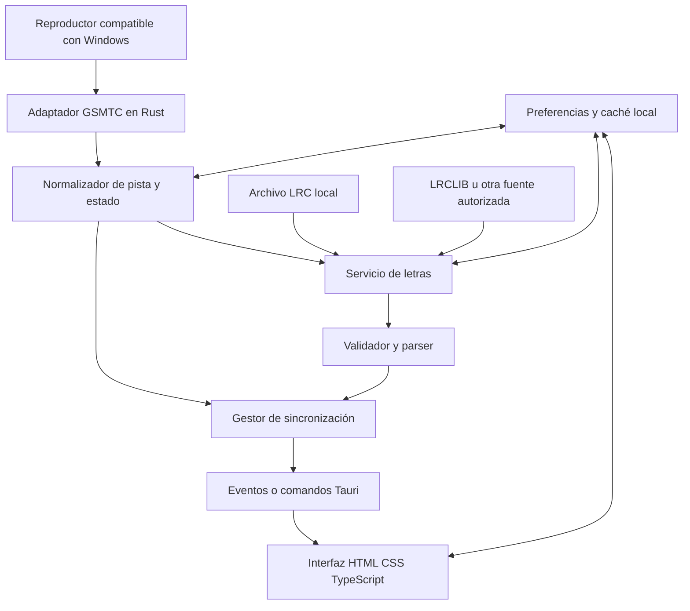

# Especificación de requisitos — Widget de música con letras sincronizadas

> **Tipo de documento:** contexto de proyecto + especificación funcional y técnica (PRD/SRS inicial)  
> **Versión:** 0.1.0 (borrador para implementación)  
> **Fecha:** 15 de noviembre de 2026  
> **Plataforma inicial:** Windows 10/11  
> **Tecnología propuesta:** Rust + Tauri 2 + HTML/CSS/TypeScript  
> **Estado:** propuesta; no representa funcionalidades implementadas

---

## 1. Contexto del proyecto

Se desea desarrollar una aplicación de escritorio **ligera, configurable y visualmente atractiva** que funcione como un widget flotante para mostrar información de la música que se reproduce en el equipo y sus **letras sincronizadas**, con una experiencia similar a un karaoke.

El usuario escucha música principalmente mediante **Spotify** o **YouTube Music** y quiere visualizar las letras sin tener que mantener abierta la ventana del reproductor. La aplicación debería poder permanecer siempre visible encima de otras ventanas, comportarse como una ventana normal o situarse debajo de otras ventanas. También interesa que pueda reducirse a un *overlay* transparente de solo letras.

**Decisión arquitectónica inicial:** priorizar la detección de sesiones multimedia del sistema operativo, evitando exigir una cuenta conectada para el MVP. Las integraciones directas de cada proveedor quedarán sujetas a capacidades técnicas, permisos y condiciones de uso.

**Punto crítico de cumplimiento:** que Windows entregue metadatos o posición de reproducción **no significa** que esté permitido distribuir una integración de letras sincronizadas para cualquier servicio. En particular, la documentación de Spotify prohíbe sincronizar grabaciones accedidas mediante su plataforma con letras u otros medios visuales. Antes de incluir oficialmente la sincronización con Spotify en un producto distribuido deberá validarse la autorización aplicable. No se debe presentar una implementación local basada en Windows como mecanismo para eludir esa política.

### 1.1 Problema que se busca resolver

- Consultar letras mientras se utiliza cualquier otra aplicación es incómodo si se necesita cambiar constantemente de ventana.
- Las letras del reproductor original pueden no estar disponibles en el formato visual deseado.
- El usuario quiere personalizar tamaño, transparencia, posición, estilo y comportamiento de la ventana.
- Se desea evitar recopilar credenciales o depender de servicios externos de autenticación para la versión inicial.

### 1.2 Propuesta de valor

Un **widget universal y modular** que observe una sesión multimedia compatible, encuentre una letra autorizada para mostrarla, la sincronice con la reproducción y la presente con diseño personalizable. El widget **no necesita reproducir audio propio** en la primera versión.

---

## 2. Objetivos

### 2.1 Objetivo general

Crear una aplicación Windows desarrollada con Rust y Tauri 2 que pueda presentar datos de una sesión multimedia activa y mostrar letras con sincronización temporal, respetando las condiciones de uso de los servicios y las licencias del contenido.

### 2.2 Objetivos específicos

1. Detectar sesiones multimedia compatibles del equipo.
2. Permitir seleccionar la sesión que se desea seguir.
3. Mostrar título, artista, duración, estado de reproducción y carátula cuando existan.
4. Consultar una fuente de letras y distinguir letras simples, temporizadas por línea y temporizadas por palabra.
5. Sincronizar la línea visible con la posición informada por el reproductor, admitiendo compensación manual.
6. Alternar entre modos de ventana: encima, normal y debajo.
7. Ofrecer una vista compacta y otra de solo letras.
8. Funcionar en segundo plano desde el área de notificación de Windows.
9. Almacenar configuración local y una caché acotada, respetando derechos y restricciones de la fuente.
10. Mantener desacopladas las fuentes multimedia, las fuentes de letras y la interfaz.

### 2.3 Fuera del alcance del MVP

- Reproducir o descargar canciones de Spotify o YouTube Music dentro de la aplicación.
- Descargar, descifrar o extraer audio protegido, evadir DRM o acceder a APIs privadas mediante ingeniería inversa.
- Garantizar compatibilidad con todos los navegadores y reproductores.
- Generar automáticamente marcas por palabra a partir de música protegida.
- Karaoke con micrófono, puntuación vocal o separación de voces.
- Sincronización entre varios computadores o una cuenta en la nube.
- Publicación comercial antes de revisar permisos de contenido y condiciones de las plataformas.

---

## 3. Usuarios y escenarios

**Usuario principal:** persona que escucha música en su computador mientras trabaja, programa o navega y quiere ver las letras sin perder el contexto de la aplicación que utiliza.

**Escenario A — Música mientras trabaja**  
El usuario reproduce una canción en una aplicación compatible. Abre el widget, selecciona la sesión de reproducción y mantiene las letras visibles sobre su editor.

**Escenario B — Letras como overlay**  
El usuario elige «Solo letras», activa transparencia y fija una posición en pantalla. El widget no muestra carátula ni controles hasta que se abra su panel de ajustes.

**Escenario C — Sin letra disponible**  
La canción se detecta correctamente, pero la fuente de letras no ofrece resultados válidos. Se informa de forma clara, sin inventar contenido, y se permite cargar un archivo LRC local autorizado.

**Escenario D — Varias fuentes abiertas**  
Hay una pestaña de YouTube Music y una aplicación multimedia adicionales. El usuario elige manualmente la sesión que seguirá el widget; opcionalmente activa seguimiento de sesión actual.

**Escenario E — Contenido con restricciones de sincronización**  
El proveedor restringe el uso de contenido con letras. La aplicación no debe activar una integración que infrinja esas condiciones; se podrá validar la sincronización con contenido propio, autorizado o de prueba.

---

## 4. Requisitos funcionales

**Prioridad:** P0 = imprescindible MVP; P1 = siguiente entrega; P2 = futuro opcional.

| ID | Prioridad | Requisito | Criterio de aceptación resumido |
|---|---|---|---|
| RF-001 | P0 | Enumerar sesiones multimedia disponibles mediante Windows GSMTC | Se listan las sesiones compatibles sin pedir contraseña del servicio. |
| RF-002 | P0 | Seleccionar una sesión a seguir | Cambiar la selección actualiza la fuente de metadatos y tiempo. |
| RF-003 | P0 | Leer título, artista, duración y estado, si existen | La UI representa correctamente campos ausentes. |
| RF-004 | P0 | Obtener posición temporal, cuando la sesión la exponga | Se usa la línea de tiempo de la sesión y se registra su confiabilidad. |
| RF-005 | P0 | Detectar cambios de canción, pausa, reanudación y búsqueda | La letra se recalcula ante esos eventos sin conservar texto de la pista anterior. |
| RF-006 | P0 | Cargar archivos `.lrc` locales | Se leen marcas `[mm:ss.xx]` con validación y manejo de errores. |
| RF-007 | P0 | Consultar letras con un proveedor configurable (inicialmente LRCLIB, sujeto a derechos) | Coincidencias dudosas no se aceptan silenciosamente. |
| RF-008 | P0 | Mostrar letras sincronizadas por línea | Se destaca la línea correcta según el tiempo efectivo. |
| RF-009 | P0 | Compensación manual de sincronía | El usuario puede adelantar o atrasar las letras en milisegundos. |
| RF-010 | P0 | Modos de ventana: siempre encima, normal, siempre debajo | El cambio de modo no requiere reiniciar. |
| RF-011 | P0 | Mover, redimensionar y recordar posición | Tras reiniciar, la ventana restaura valores válidos en el monitor disponible. |
| RF-012 | P0 | Vista compacta de reproductor y vista de solo letras | Alternar vistas no interrumpe seguimiento ni sincronización. |
| RF-013 | P0 | Estados de interfaz para espera, sin sesión, sin letra, error y pausa | Los mensajes son distintos y accionables. |
| RF-014 | P0 | Persistir preferencias locales | Los ajustes sobreviven a un cierre normal. |
| RF-015 | P1 | Controles reproducir/pausar, anterior y siguiente | Solo se habilitan si la sesión permite la acción. |
| RF-016 | P1 | Carátula, barra de progreso y tiempo transcurrido | Se muestra degradación elegante si faltan datos. |
| RF-017 | P1 | Ícono de bandeja del sistema con menú contextual | Desde la bandeja se puede mostrar/ocultar, abrir ajustes y salir. |
| RF-018 | P1 | Letras por palabra cuando la fuente entrega marcas temporales individuales | Animación progresiva, sin inventar tiempos ausentes. |
| RF-019 | P1 | Apariencia configurable: tamaño de fuente, opacidad, colores y alineación | Los cambios se previsualizan y se guardan. |
| RF-020 | P1 | Selección automática entre sesiones con opción de fijar una | El comportamiento es determinista y controlable por el usuario. |
| RF-021 | P1 | Caché local con vencimiento y borrado manual | Se respeta la licencia y política de retención de cada fuente. |
| RF-022 | P2 | Atajos globales configurables | No interfieren con accesos frecuentes del sistema. |
| RF-023 | P2 | Modo «clics atraviesan el overlay» (click-through) | Existe un atajo o acción de bandeja para desactivarlo y recuperar el control. |
| RF-024 | P2 | Adaptador para una extensión de navegador | Solo recibe mensajes desde una extensión autorizada y canal local validado. |
| RF-025 | P2 | Compatibilidad con proveedores adicionales de letras | Cada proveedor implementa el mismo contrato interno. |

### 4.1 Reglas del comportamiento de ventana

| Modo | Comportamiento esperado | Observaciones |
|---|---|---|
| Siempre encima | Ventana sobre las ventanas normales | Puede no mostrarse encima de juegos en pantalla completa exclusiva u otras superficies protegidas. |
| Normal | Sigue el orden convencional de ventanas | Al activar otra aplicación puede quedar oculta. |
| Siempre debajo | Se mantiene debajo de otras ventanas | **No equivale** a incrustar el widget en el fondo del escritorio. |
| Solo letras | Reduce la UI visible y utiliza fondo transparente | Es una vista independiente del nivel de ventana elegido. |
| Oculto | No aparece la ventana principal; el proceso puede seguir activo | Se recupera desde la bandeja del sistema. |

Los modos **encima** y **debajo** deben ser mutuamente excluyentes.

### 4.2 Reglas de visualización de letras

- Priorizar letra sincronizada por palabra **solo** si existe información confiable de tiempos individuales.
- Si existe LRC con tiempos por línea, destacar una línea entera y mostrar opcionalmente anterior/siguiente.
- Si solo existe letra sin tiempos, mostrarla en modo lectura, **sin atribuirle sincronización real**.
- Si no hay letra, ofrecer selección manual de archivo local o reintento.
- Admitir desplazamiento automático suave y desactivación de animaciones.
- No mostrar contenido de otra pista mientras se resuelve la nueva consulta.
- No asumir que dos versiones de la misma canción (en vivo, remix, radio edit) comparten marcas de tiempo.

---

## 5. Detección de reproducción y fuentes

### 5.1 Integración principal: Windows GSMTC

Usar la API **Global System Media Transport Controls** de Windows mediante el crate `windows` de Rust y sus interfaces WinRT:

- `GlobalSystemMediaTransportControlsSessionManager::RequestAsync` para obtener el administrador.
- `GetSessions` y `GetCurrentSession` para enumerar o seleccionar la sesión.
- `TryGetMediaPropertiesAsync` para consultar propiedades multimedia.
- `GetPlaybackInfo` para estado y capacidades.
- `GetTimelineProperties` para la información temporal.
- Eventos `SessionsChanged`, `CurrentSessionChanged`, `MediaPropertiesChanged`, `PlaybackInfoChanged` y `TimelinePropertiesChanged` cuando correspondan.
- Métodos `TryPlayAsync`, `TryPauseAsync`, `TrySkipNextAsync` y `TrySkipPreviousAsync` solo si las capacidades de sesión admiten controles.

**Importante:** GSMTC no garantiza que cada aplicación publique todos los datos, ni que la posición reportada cambie continuamente. Es necesario probar la aplicación concreta y el navegador concreto en Windows 10/11.

### 5.2 Spotify

- **MVP:** no exigir conexión OAuth; la exploración técnica de sesiones Windows se hace sin declarar soporte oficial o autorizado de letras sincronizadas para Spotify.
- **Integración directa futura:** Spotify Web API ofrece endpoints para obtener reproducción actual y progreso mediante OAuth, pero su uso está sujeto a sus políticas.
- **Restricción crítica:** los documentos de Spotify prohíben la sincronización de su contenido con letras y otros medios. No se debe implementar ni distribuir esa función mediante Spotify Platform sin obtener los permisos necesarios.
- **Acceso para desarrolladores (2026):** el modo de desarrollo requiere que el propietario de la aplicación tenga Spotify Premium; para aplicaciones nuevas aplica el límite de un Client ID por desarrollador y hasta cinco usuarios autorizados. Los endpoints disponibles también están restringidos. Verificar las condiciones vigentes antes de crear la integración.

### 5.3 YouTube Music

- **MVP:** probar la reproducción mediante el navegador y GSMTC, sin depender de una integración de cuenta.
- **Limitación:** no se presupone una API pública oficial de YouTube Music que entregue el estado y la posición de reproducción como Spotify Web API.
- **Posible mejora:** una extensión voluntaria del navegador podría enviar el estado permitido de la pestaña a un servicio local. Debe analizarse previamente su compatibilidad con políticas de YouTube, privacidad y requisitos de distribución.
- **No permitido en el diseño:** extracción de tokens privados, scraping de sesiones autenticadas, elusión de DRM o mecanismos diseñados para esquivar restricciones de la plataforma.

### 5.4 Proveedores de letras

**Primario propuesto: LRCLIB** (`https://lrclib.net/docs`). La API contempla letras normales (`plainLyrics`), LRC con tiempos por línea (`syncedLyrics`) y `lyricsfile` con posibles tiempos por palabra (`hasWordSync`). Permite acceso anónimo con límites de uso; solicita identificación del cliente mediante `User-Agent` o cabeceras alternativas. El acceso gratuito no concede automáticamente derechos para toda forma de uso o redistribución de letras.

Estrategia de búsqueda:

1. Normalizar artista y título de la sesión; conservar también originales.
2. Añadir álbum y duración si están disponibles.
3. Buscar coincidencia exacta y validar duración (para `/api/get`, LRCLIB indica una tolerancia aproximada de ±2 s cuando se usa duración).
4. Si hay varias coincidencias, asignar puntuación y permitir selección manual cuando la confianza sea insuficiente.
5. Priorizar datos sincronizados; guardar procedencia, identificación y condiciones de uso de cada resultado.
6. Implementar espera incremental y manejo de `429`/errores sin saturar la API.
7. Permitir importar archivos LRC locales con derechos adecuados.

**No asumir** que LRCLIB garantiza todas las canciones o letras por palabra.

---

## 6. Sincronización temporal

### 6.1 Modelo

Separar el reloj de reproducción del reloj de renderizado:

- `position_ms`: posición conocida de la sesión multimedia.
- `sampled_at_monotonic`: instante local monotónico en que se observó esa posición.
- `is_playing`: estado actual de reproducción.
- `offset_ms`: ajuste manual aplicado por el usuario a las letras.
- `effective_position_ms`: posición estimada sobre la que se buscan marcas temporales.

Si la reproducción sigue activa y la información temporal es confiable:

```text
effective_position_ms = position_ms
  + elapsed_monotonic_since_sample_ms
  + offset_ms
```

Si está pausada, **no** debe incrementarse el tiempo. Si se detecta búsqueda, cambio de pista o salto brusco, se vuelve a anclar el reloj al valor publicado por la sesión. Limitar la extrapolación cuando la fuente deje de actualizar o tenga confianza baja.

> Convención propuesta: `offset_ms > 0` adelanta la letra respecto a la canción; `offset_ms < 0` la retrasa. Esta convención deberá mantenerse consistente en interfaz, almacenamiento y pruebas.

### 6.2 Estrategia de actualización

- Consumir eventos de cambios de sesión, metadatos, reproducción y línea temporal.
- Refrescar el estado ocasionalmente como respaldo, con una frecuencia prudente y configurable.
- Animar en la capa visual de manera independiente de las consultas de red.
- Buscar la línea con la última marca temporal menor o igual al tiempo efectivo.
- Interrumpir solicitudes de letras obsoletas al cambiar de pista, o descartar sus resultados mediante un identificador de generación.
- Corregir *drift* al recibir una nueva posición fiable.
- Diferenciar saltos genuinos de pequeñas variaciones de reporte para evitar parpadeos.

### 6.3 Sincronización por palabra

La animación progresiva solo se ofrece si cada palabra dispone de tiempo de inicio y/o duración confiable. No crear una falsa precisión dividiendo uniformemente el tiempo de una línea entre sus palabras. Si los datos no son suficientes, utilizar el modo por línea.

---

## 7. Arquitectura propuesta



### 7.1 Capas

| Capa | Tecnología | Responsabilidad |
|---|---|---|
| Backend escritorio | Rust + Tauri 2 | Ciclo de vida, comandos, eventos, almacenamiento y coordinación. |
| Integración Windows | Crate `windows` (WinRT) | Consultar sesiones GSMTC, leer metadatos y tiempos, ejecutar controles permitidos. |
| Servicio de letras | Rust + cliente HTTP | Buscar, validar, analizar formatos y aplicar políticas de caché. |
| Sincronización | Rust o módulo TypeScript bien delimitado | Convertir tiempo de sesión a línea/palabra activa. |
| Frontend | HTML/CSS/TypeScript | Ventanas, interacción, animaciones, temas y accesibilidad. |
| Configuración | JSON/TOML local | Guardar preferencias y configuración general. |
| Caché opcional | SQLite | Guardar metadatos, elecciones y contenido cuando la licencia lo permita. |
| Integración de sistema | Tauri window/tray APIs | Estados de ventana, bandeja, tamaño, posiciones y ocultación. |

**Nota de elección tecnológica:** Rust no tiene por qué reproducir audio. Rodio solo se incorporaría si se agrega más adelante reproducción de archivos locales, que es un objetivo distinto del MVP.

### 7.2 Contratos internos sugeridos (conceptuales)

```text
MediaSource
  list_sessions() -> Session[]
  select_session(id) -> Result
  get_track() -> TrackMetadata?
  get_timeline() -> PlaybackTimeline?
  subscribe_events() -> EventStream
  transport(command) -> Result

LyricsProvider
  search(track: TrackMetadata) -> LyricsCandidate[]
  fetch(candidate_id) -> LyricsDocument

LyricsDocument
  source: string
  format: plain | line_synced | word_synced
  lines: LyricsLine[]
  rights_metadata: optional

WindowController
  set_z_order(top | normal | bottom)
  set_mode(compact | lyrics_only)
  show() / hide()
```

Se recomienda mantener estos contratos desacoplados de los tipos concretos de Tauri para poder probarlos con dobles y adaptar futuros proveedores.

### 7.3 Estructura de carpetas sugerida

```text
music-lyrics-widget/
├── README.md
├── docs/
│   ├── requirements.md
│   ├── architecture.md
│   └── compliance.md
├── src/                       # Frontend
│   ├── components/
│   │   ├── CompactPlayer/
│   │   ├── LyricsOverlay/
│   │   └── SettingsPanel/
│   ├── services/
│   ├── styles/
│   └── types/
├── src-tauri/
│   ├── capabilities/
│   ├── src/
│   │   ├── media/
│   │   │   ├── mod.rs
│   │   │   └── windows_gsmtc.rs
│   │   ├── lyrics/
│   │   │   ├── mod.rs
│   │   │   ├── lrclib.rs
│   │   │   └── lrc_parser.rs
│   │   ├── sync/
│   │   ├── settings/
│   │   ├── commands/
│   │   └── lib.rs
│   └── tauri.conf.json
└── tests/
```

---

## 8. Diseño de interfaz

### 8.1 Vista compacta

- Carátula (si existe).
- Nombre de canción y artista.
- Estado de reproducción y progreso.
- Controles compatibles con la sesión (opcionales en MVP).
- Línea activa y una línea anterior/siguiente.
- Botón de fijar nivel de ventana y acceso a ajustes.

### 8.2 Vista «solo letras»

- Ventana sin marco y fondo transparente.
- Texto centrado o alineado según preferencia.
- Una a tres líneas, con énfasis en la actual.
- Tamaño, peso, sombra/contorno y opacidad configurables.
- Posibilidad de mover y cambiar de tamaño mediante un modo de edición visible.
- Animaciones suaves opcionales; respetar preferencia de movimiento reducido.

### 8.3 Ajustes

- Sesión automática o sesión fija.
- Modo de ventana: encima, normal, debajo.
- Modo de vista: compacta o solo letras.
- Idioma de la aplicación (inicialmente español).
- Tema, opacidad, tamaño de fuente, alineación y cantidad de líneas.
- Ajuste de desfase temporal en milisegundos.
- Arranque con Windows (optativo; no automático por defecto).
- Permiso para red y caché, con controles de borrado.
- Opción para volver a configuración visual predeterminada si la ventana queda fuera de la pantalla.

---

## 9. Requisitos no funcionales

| ID | Requisito | Objetivo / comprobación |
|---|---|---|
| RNF-001 | Compatibilidad | Windows 10/11 en versiones que soporten GSMTC y Tauri 2; validar las compilaciones objetivo. |
| RNF-002 | Rendimiento | Interfaz fluida y sin consultas de red por fotograma. Objetivos de CPU y RAM se fijarán con mediciones reales. |
| RNF-003 | Inicio | Mostrar la interfaz sin depender de la respuesta de una API externa. |
| RNF-004 | Robustez | Falta de sesión, metadatos o letras no provoca bloqueos. |
| RNF-005 | Privacidad | No solicitar credenciales de Spotify/Google para la integración principal. |
| RNF-006 | Seguridad | Limitar capacidades Tauri; validar entradas; proteger cualquier token futuro con almacenamiento seguro del sistema. |
| RNF-007 | Resiliencia de red | Soportar desconexión, tiempos de espera, `429` y respuestas incompletas. |
| RNF-008 | Accesibilidad | Contraste configurable, escalado de texto, teclado y opción de reducir movimiento. |
| RNF-009 | Multipantalla | Restaurar posición dentro del área visible, considerando DPI y cambios de monitor. |
| RNF-010 | Mantenibilidad | Adaptadores multimedia y proveedores de letras desacoplados. |
| RNF-011 | Diagnóstico | Registros de error sin almacenar tokens, contraseñas ni historial completo de escucha por defecto. |
| RNF-012 | Cumplimiento | Verificar condiciones de APIs, licencias de letras y derechos de exhibición antes de distribuir. |

---

## 10. Seguridad, privacidad y licencias

1. **No introducir credenciales de servicios musicales** en el widget ni guardarlas localmente en texto plano.
2. Usar HTTPS para consultas de letras; definir `User-Agent` identificable y respetar los límites publicados por LRCLIB.
3. Permitir desactivar consultas externas; una pista local con archivo LRC debe funcionar sin conexión.
4. No registrar todo el historial musical de forma predeterminada; la caché debe ser opcional y controlable.
5. Configurar permisos mínimos de Tauri para operaciones de ventanas; incluir solo los necesarios, como `core:window:allow-set-always-on-top` y `core:window:allow-set-always-on-bottom` cuando se utilicen desde JavaScript.
6. Proteger cualquier servidor local futuro contra solicitudes de otros sitios web, orígenes no permitidos y mensajes falsificados.
7. Documentar qué servicio entrega cada letra y qué derechos de visualización, almacenamiento y redistribución se aplican.
8. **Spotify:** obtener revisión legal o autorización antes de anunciar o distribuir funcionalidades que sincronicen grabaciones de Spotify con letras. La existencia de un método técnico no modifica las obligaciones contractuales.
9. **YouTube Music:** evaluar condiciones de uso antes de incorporar extensiones o integraciones específicas.
10. Si no es posible acreditar derechos de distribución, priorizar letras propias, dominio público verificado, material expresamente licenciado o archivos LRC aportados lícitamente por el usuario.

---

## 11. Plan de implementación

### Fase 0 — Validación técnica y de cumplimiento

- [ ] Crear prototipo de Tauri 2 y probar las tres posiciones de ventana.
- [ ] Probar transparencia, movimientos, DPI y vista solo letras.
- [ ] Probar GSMTC con un reproductor o material **autorizado** que publique metadatos y posición.
- [ ] Medir estabilidad temporal, pausa y búsqueda.
- [ ] Revisar términos de fuente de letras y usos autorizados.
- [ ] Definir alcance admitido para Spotify y YouTube Music sin prometer compatibilidad prohibida.

**Salida:** demostración con datos de prueba y matriz de compatibilidad documentada.

### Fase 1 — MVP funcional

- [ ] Detectar y listar sesiones multimedia.
- [ ] Obtener pista, estado y tiempo.
- [ ] Importar un archivo LRC local.
- [ ] Analizar marcas por línea y seleccionar la línea activa.
- [ ] Mostrar vista compacta y solo letras.
- [ ] Alternar ventana encima/normal/debajo.
- [ ] Guardar ajustes y ajuste manual de desfase.
- [ ] Mostrar estados de error y ausencia de metadatos.
- [ ] Crear pruebas de sincronización con pistas de demostración autorizadas.

**Salida:** ejecutable Windows que presenta letras LRC de material permitido sincronizadas con una sesión compatible.

### Fase 2 — Fuentes y experiencia de usuario

- [ ] Integrar consulta responsable a LRCLIB para casos de uso autorizados.
- [ ] Validar coincidencia por título, artista, álbum y duración.
- [ ] Añadir selección manual de letras candidatas.
- [ ] Implementar bandeja del sistema y acciones básicas.
- [ ] Incorporar carátula, barra de progreso, temas y mejores animaciones.
- [ ] Añadir caché respetuosa con políticas de licencia.

**Salida:** versión beta para pruebas de compatibilidad y experiencia de uso.

### Fase 3 — Mejoras opcionales

- [ ] Resaltado por palabra cuando la fuente tenga marcas individuales.
- [ ] Atajos globales y click-through recuperable.
- [ ] Más proveedores de letras con derechos comprobados.
- [ ] Extensión de navegador opcional, previa revisión de políticas.
- [ ] Instalador, actualización y firma del ejecutable si corresponde.

**Salida:** versión de producto, únicamente tras resolver cumplimiento y pruebas.

---

## 12. Pruebas y criterios de aceptación del MVP

| Prueba | Pasos | Resultado esperado |
|---|---|---|
| CA-001 | Abrir aplicación sin reproductor | Estado «Sin sesión», sin fallos. |
| CA-002 | Iniciar sesión multimedia de prueba | Detecta pista y permite seleccionarla. |
| CA-003 | Cargar un LRC válido | Las marcas se analizan y se ordenan correctamente. |
| CA-004 | Reproducir una pista autorizada con tiempos conocidos | La línea activa coincide con el tiempo reportado. |
| CA-005 | Pausar | La línea permanece estable; no sigue avanzando. |
| CA-006 | Retroceder o adelantar pista | La línea se recalcula inmediatamente al recibir el nuevo tiempo. |
| CA-007 | Cambiar de canción | Se elimina contenido de la canción anterior antes de mostrar la nueva letra. |
| CA-008 | Desactivar internet y usar LRC local | La sincronización continúa sin consultar servicios externos. |
| CA-009 | Activar siempre encima y luego normal | El nivel de ventana se actualiza sin reinicio. |
| CA-010 | Activar siempre debajo | Queda detrás de otras ventanas normales, según capacidades del sistema. |
| CA-011 | Cerrar y reabrir | Conserva modo visual, ajustes de letra y posición visible. |
| CA-012 | Abrir canción sin letra | Muestra mensaje de ausencia sin texto inventado. |
| CA-013 | Probar metadatos incompletos | No se bloquea; muestra valores de respaldo. |
| CA-014 | Recibir respuestas tardías de búsqueda anterior | La letra antigua no reemplaza a la de la canción actual. |

**Definición de terminado (MVP):** todas las pruebas CA-001 a CA-014 superadas en una compilación Windows definida, sin secretos incrustados ni mecanismos de extracción de contenido, con documentación de limitaciones y derechos.

---

## 13. Riesgos, dependencias y decisiones pendientes

| Riesgo / incógnita | Impacto | Mitigación propuesta |
|---|---|---|
| Spotify restringe la sincronización de grabaciones con letras | Muy alto para una integración Spotify pública | No anunciar ni distribuir esa función sin autorización y revisión de política. |
| Licencia y derechos de letras no claros | Alto | Definir fuentes/uso permitidos y controlar retención y distribución. |
| Sesiones multimedia sin posición precisa | Alto | Medir confiabilidad, extrapolar con reloj monotónico y permitir desfase. |
| YouTube Music no expone sesión completa en ciertos navegadores | Medio/alto | Matriz de navegadores; degradación elegante y selección manual. |
| Coincidencias erróneas entre versiones de canciones | Medio | Verificación de duración, álbum y confirmación manual. |
| Juegos con pantalla completa exclusiva | Medio | Explicar que «siempre encima» no es una superposición garantizada en todos los juegos. |
| Posición de ventana fuera de monitor después de cambiar pantallas | Medio | Clampear coordenadas a áreas visibles. |
| API pública con límites o caídas | Medio | Caché permitida, reintentos prudentes y funcionamiento con archivos locales. |

### Decisiones por cerrar antes de construir una versión distribuible

1. ¿El programa será exclusivamente personal, abierto a terceros o comercial?
2. ¿La primera experiencia priorizará una ventana compacta o texto flotante?
3. ¿Se mostrará solo una línea o una línea actual con anterior/siguiente?
4. ¿Qué reproductores y navegadores serán objetivos de pruebas de compatibilidad?
5. ¿Qué proveedores/colecciones autorizadas de letras pueden usarse legalmente?
6. ¿La sincronización por palabra será un objetivo posterior condicionado a su disponibilidad?

**Valores predeterminados propuestos mientras no se decida:** aplicación para Windows 10/11; interfaz compacta + solo letras; tres líneas; sesión seleccionable; LRC local en el MVP; sincronización por palabra en fase posterior; sin cuentas conectadas.

---

## 14. Referencias verificadas (consulta: 15-11-2026)

- Microsoft — GSMTC Session Manager: https://learn.microsoft.com/en-us/uwp/api/windows.media.control.globalsystemmediatransportcontrolssessionmanager
- Microsoft — Sesiones y controles multimedia: https://learn.microsoft.com/en-us/uwp/api/windows.media.control.globalsystemmediatransportcontrolssession
- Microsoft — Timeline: https://learn.microsoft.com/en-us/uwp/api/windows.media.control.globalsystemmediatransportcontrolssession.gettimelineproperties
- Tauri 2 — API de ventanas: https://v2.tauri.app/reference/javascript/api/namespacewindow/
- LRCLIB — Documentación de API, límites y formatos: https://lrclib.net/docs
- Spotify — Developer Policy: https://developer.spotify.com/policy
- Spotify — Compliance Tips (incluye restricciones de sincronización con letras): https://developer.spotify.com/compliance-tips
- Spotify — Current Playback: https://developer.spotify.com/documentation/web-api/reference/get-information-about-the-users-current-playback
- Spotify — Cambios de modo de desarrollo, febrero de 2026: https://developer.spotify.com/documentation/web-api/tutorials/february-2026-migration-guide

---

## 15. Instrucciones de contexto para un asistente de desarrollo

> Este documento es la referencia de requisitos inicial del proyecto. Implementa por fases y prioriza el MVP. La aplicación principal es un **widget de visualización/sincronización**, no un reproductor que descargue audio. Mantén el backend Rust desacoplado del frontend de Tauri y de las fuentes de letras. Comienza con sesiones GSMTC y archivos LRC locales autorizados. Implementa los tres modos de ventana y las dos vistas. Prueba los estados de pausa, búsqueda, ausencia de metadatos, cambios de pista y sesiones múltiples. No inventes letras ni tiempos por palabra. No asumas que técnicamente poder leer una sesión de Spotify o YouTube Music autoriza a sincronizar o distribuir letras relacionadas con su contenido. Documenta incertidumbres y solicita una decisión de producto solo cuando sea imprescindible para evitar incumplimientos.
